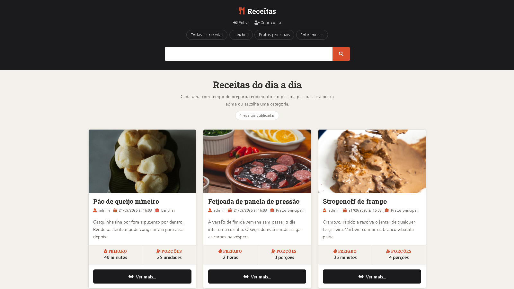

# Recipes

A recipe site built with Django. It's a study project, written test-first.

**Live:** https://receitas-arthur.onrender.com<br>
<sub>The first visit can take up to a minute: the free server sleeps when idle.</sub>

[](https://github.com/artvsantos/django-projeto1/actions/workflows/ci.yml)
[](https://www.djangoproject.com)
[](#tests)
[](LICENSE)

[Versão em português](README.md)



## What it does

- Home page listing published recipes, paginated
- Search by title or description
- Recipes filtered by category
- A page for each recipe
- Django admin for adding recipes and categories, with cover image upload
- Author sign-up, with strong password checks and unique e-mail
- Log in and log out, with protection against redirects to other sites
- Author dashboard: each author submits, edits and deletes their own recipes, which only go live after approval in the admin
- REST API at `/api/v1/`: open for reading, and authors create and edit their own recipes with a token (see below)

Pagination isn't Django's out of the box. There's a function in `utils/pagination.py` that builds the range of page numbers around the current page without running past either end of the list. It has the most edge cases in the project, and the most tests.

## API

A REST API built with Django REST Framework. Opened in a browser it shows a browsable page; from `curl` or another program it returns JSON.

Reading is open to anyone:

| Endpoint | Returns |
| --- | --- |
| `GET /api/v1/recipes/` | Published recipes, 10 per page. Filters: `?search=cake` and `?category=1` |
| `GET /api/v1/recipes/<id>/` | One recipe, including the preparation steps |
| `GET /api/v1/categories/` | Categories that have published recipes, with a count for each |

Authors manage their own recipes with a token:

| Endpoint | What it does |
| --- | --- |
| `POST /api/v1/token/` | Takes `username` and `password` and returns the token. At most 5 attempts per minute |
| `DELETE /api/v1/token/` | Deletes the token (log out) |
| `GET/POST /api/v1/my-recipes/` | Lists your recipes, published or not, and creates a new one |
| `GET/PUT/PATCH/DELETE /api/v1/my-recipes/<id>/` | Shows, edits or deletes one of your recipes |

```bash
curl "https://receitas-arthur.onrender.com/api/v1/recipes/?search=queijo"

curl -X POST https://receitas-arthur.onrender.com/api/v1/token/ \
     -d username=YOUR_USERNAME -d password=YOUR_PASSWORD
# {"token": "..."}

curl https://receitas-arthur.onrender.com/api/v1/my-recipes/ \
     -H "Authorization: Token YOUR_TOKEN"
```

The rules are the same as the dashboard's, and they come from the same place (`recipes/validation.py`): a recipe created or edited through the API stays offline until the admin approves it, another author's recipe returns 404, and authors can't publish themselves or send HTML. The author's private data (e-mail, password) never shows up, and the public list always runs 2 database queries no matter how many recipes are on the page. All of that is tested.

## Tests

207 tests, 99% coverage.

They cover the models, the URLs, the views, the forms, the dashboard permissions (nobody can touch another author's recipe) and the pagination range. Models, views and URLs sit at 100%; pagination is at 93%, and that's where the edge cases live.

Settings, migrations and the seed command are excluded from the measurement. They aren't application code, and counting them would only pad the number.

I use `parameterized` to check several fields without writing the same test five times over, and `Faker` builds the test recipes through a factory in `utils/recipes/factory.py`.

```bash
pytest

coverage run -m pytest
coverage report
coverage html   # browsable report at htmlcov/index.html
```

## Stack

Python 3.11, Django 5.2, Django REST Framework, SQLite, pytest, coverage, python-dotenv, Pillow. In production: Postgres, WhiteNoise, gunicorn and Cloudinary for the photos.

## Running it locally

```bash
git clone https://github.com/artvsantos/django-projeto1.git
cd django-projeto1

python -m venv venv
source venv/bin/activate        # Windows: venv\Scripts\activate

pip install -r requirements.txt
pip install -r requirements-dev.txt   # only if you want to run the tests

cp .env-exemple .env            # Windows: copy .env-exemple .env
# change SECRET_KEY in .env

python manage.py migrate
python manage.py createsuperuser
python manage.py runserver
```

It runs at http://localhost:8000, and the admin is at /admin.

A recipe only shows up on the site once `is_published` is checked.

## Project layout

```
projeto/          settings, urls, wsgi/asgi
recipes/          main app
  models.py       Recipe and Category
  views.py        home, search, category, recipe
  tests/          the test suite
  templates/      pages and partials
authors/          sign-up, log in, log out and author dashboard
  forms.py        RegisterForm, LoginForm and RecipeForm
  views.py        account and dashboard (create, edit, delete recipe)
api/              REST API (Django REST Framework)
  serializers.py  the JSON shape
  views.py        recipes and categories (read), token and author recipes
utils/
  pagination.py   page range calculation
  recipes/        factory for fake recipes
base_templates/   base template
base_static/      global css
```

## License

MIT. See [LICENSE](LICENSE).
